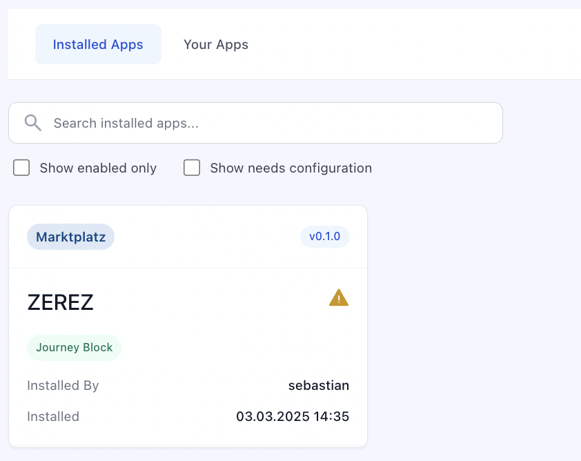

# App Options

App Options are the settings an organization fills in when installing your app — API URLs, feature toggles, credentials. You declare them **once, at the top level of the manifest**, and every part of your app reads from the same set of values: components, [functions](/docs/apps/functions/overview), the [API Proxy](/docs/apps/components/api-proxy) and [Portal Extension](/docs/apps/components/portal-extension) hooks.

:::info Options used to live on components
Earlier app versions declared options per component. That model is retired: all existing component options were migrated to app level, and the platform transparently keeps serving them to consumers that still read options from components. Declare new options only at the top level — deploys that declare an option on a component with the same key as an app-level option are rejected.
:::

## Declaring options

Add a top-level `options` array to your `manifest.json`:

```json title="manifest.json"
{
  "name": "My Integration",
  "options": [
    { "key": "api_base_url", "label": "API Base URL", "type": "text", "required": true },
    { "key": "sync_enabled", "label": "Enable sync", "type": "boolean" },
    { "key": "api_key", "label": "API Key", "type": "secret", "required": true },
    { "key": "internal_hint", "label": "Routing hint", "type": "text", "sensitive": true }
  ],
  "components": [ ... ]
}
```

| Field | Required | Description |
|---|---|---|
| `key` | ✓ | Unique identifier across the whole app. This is what you reference everywhere (`{{Options.api_key}}`, `input.app_options.api_key`, proxy auth) — treat it as a public contract |
| `type` | ✓ | `text`, `number`, `boolean`, `secret` or `object` |
| `label` | — | Human-readable label shown to the installing organization — a string or [translations](#translated-texts) |
| `description` | — | Help text shown below the input — a string or [translations](#translated-texts) |
| `placeholder` | — | Example shown in the empty input (`text`, `number`, `secret`) |
| `required` | — | The app installs, but is marked *partially successful* and stays unusable until all required options are filled |
| `default` | — | Value used until the organization sets one — see [Defaults](#defaults) |
| `choices` | — | Fixed set of accepted values, shown as a dropdown — see [Choices](#choices) |
| `format`, `pattern`, `min`, `max` | — | Rules a value must satisfy — see [Validating values](#validating-values) |
| `visible_if` | — | Show the option only while other options have certain values — see [Conditional options](#conditional-options) |
| `group` | — | Section the option is shown under — see [Groups](#groups) |
| `sensitive` | — | Write-only, server-side only — see below. Always `true` for `type: secret` |
| `hidden` | — | Not shown in the **App settings** card: your app sets the value from its own page — see [Hidden options](#hidden-options) |
| `repeatable` | — | The value becomes a list of entries (each gets a stable server-assigned `id`) |
| `fields` | `object` type | Declares the sub-fields of an `object` option — primitives only, no nesting |

The installing organization sees all app options in a single **App settings** card on the app's configuration page.

## Choices

Give a `text` or `number` option a fixed set of values and it is shown as a dropdown instead of a free-text field:

```json
{
  "key": "auth_mode",
  "type": "text",
  "label": "Authentication",
  "default": "none",
  "choices": [
    { "value": "none", "label": { "de": "Keine", "en": "None" } },
    { "value": "basic", "label": "Username & password" },
    { "value": "bearer" }
  ]
}
```

- The stored value is the plain `value` — your proxy, functions and `{{Options.auth_mode}}` templates see `"basic"`, never the label.
- `label` is optional; a choice without one is shown by its value.
- Values must be unique and match the option type (strings for `text`, numbers for `number`).
- Saving a value that is not one of the choices is rejected.
- For a `repeatable` option, every entry must be one of the choices.

## Defaults

`default` is the option's value for as long as the installing organization has not set one:

```json
{ "key": "timeout", "type": "number", "default": 25, "min": 1, "max": 60 }
```

- A default is the **effective value everywhere** values are read: the API Proxy, functions, browser components and [`visible_if`](#conditional-options) conditions.
- A `required` option with a default counts as filled.
- Supported for non-repeatable, non-sensitive `text`, `number` and `boolean` options. `false` and `0` are valid defaults.
- The default must itself satisfy the option's `choices`, `format`, `pattern`, `min` and `max`.
- Clearing a field brings the default back.

:::caution Changing a default changes behavior
Installations that never set a value follow the default of the version they are on. If you change a default in a new version, those installations change with it when they update.
:::

## Validating values

Rules are checked in the configuration UI as the installer types and again by the platform when the configuration is saved. A save with a value that breaks a rule is rejected with `400` and the code `INVALID_OPTION_VALUES`; nothing is stored.

| Field | Applies to | Rule |
|---|---|---|
| `format` | `text` | `hostname` (a bare host name — no scheme, port or path), `url` (an absolute `http(s)` URL) or `email` |
| `pattern` | `text`, `secret` | A regular expression the **whole** value must match (max. 200 characters). Values longer than 2000 characters never match |
| `pattern_message` | with `pattern` | Message shown when the pattern does not match — a string or [translations](#translated-texts) |
| `min`, `max` | `number` | Smallest and largest accepted value |

```json
[
  {
    "key": "api_host",
    "type": "text",
    "required": true,
    "format": "hostname",
    "placeholder": "api.example.com"
  },
  {
    "key": "customer_no",
    "type": "text",
    "pattern": "[A-Z]{2}\\d{6}",
    "pattern_message": { "de": "Zwei Großbuchstaben und sechs Ziffern", "en": "Two capital letters and six digits" }
  }
]
```

The manifest itself is validated too: `pattern_message` needs a `pattern`, and `min` must not be larger than `max`.

A few things to know:

- **Empty values are never a rule violation.** Whether a value is needed at all is what `required` is for.
- **Secrets are checked before they are encrypted**, and a rejected secret is never echoed back in the error.
- **Updating to a new version never fails on old values.** If stored values no longer fit the rules of the new version, the update goes through and the installation is disabled until an admin corrects them.

## Conditional options

`visible_if` shows an option only while other options have certain values. Use it for settings that only make sense in one mode:

```json
"options": [
  {
    "key": "auth_mode",
    "type": "text",
    "default": "none",
    "choices": [{ "value": "none" }, { "value": "basic" }, { "value": "bearer" }, { "value": "header" }]
  },
  { "key": "username", "type": "text", "required": true, "visible_if": { "auth_mode": "basic" } },
  { "key": "password", "type": "secret", "required": true, "visible_if": { "auth_mode": "basic" } },
  { "key": "token", "type": "secret", "required": true, "visible_if": { "auth_mode": ["bearer", "header"] } }
]
```

- Each entry maps an option key to the value it must have, or to a list of accepted values. **All** entries must match.
- **A hidden option is not asked for.** It does not appear in the configuration UI, and when it is `required` it does not keep the installation from being enabled. This is what lets you mark the password as required without blocking installations that use no authentication.
- The controlling option must be a non-sensitive, non-repeatable `text`, `number` or `boolean` option. Secrets cannot control visibility — their value is never readable in the browser.
- An unset controlling option falls back to its `default`. An unset `boolean` counts as `false`.
- Conditions can chain. An option whose controlling option is hidden is hidden as well.
- If the controlling option declares `choices`, the expected values must be among them — a typo like `"Basic"` is rejected on deploy.
- Deploys with a condition on an unknown option, on the option itself, or with circular conditions are rejected.

:::caution Hidden options keep their stored value
Switching from `basic` to `none` hides the password field but does not delete the stored password, so switching back needs no re-entry. The flip side: your functions and the API Proxy still receive those values. **Check the controlling option** (`auth_mode === "basic"`), not whether a password happens to be present.
:::

## Groups

Arrange options into sections with a top-level `option_groups` array and a `group` on each option:

```json title="manifest.json"
{
  "option_groups": [
    { "key": "server", "label": { "de": "Server", "en": "Server" } },
    {
      "key": "auth",
      "label": { "de": "Authentifizierung", "en": "Authentication" },
      "description": "Credentials stay server-side and never reach the browser."
    }
  ],
  "options": [
    { "key": "api_host", "type": "text", "group": "server" },
    { "key": "auth_mode", "type": "text", "group": "auth" },
    { "key": "notes", "type": "text" }
  ]
}
```

Options without a group are shown first, followed by one section per group in the order the groups are declared. Every group needs a `key` and a `label`. Group keys must be unique, and an option may only name a declared group.

## Hidden options

An option declared `hidden: true` is left out of the **App settings** card. The installing organization does not fill it in there; your app sets it from its own [Custom Page](/docs/apps/components/custom-page), through the epilot host. Everything else stays the same: the value is stored with the installation, applies to the whole organization, follows the option's rules, and reaches every consumer listed under [Consuming options](#consuming-options).

```json title="manifest.json"
{
  "options": [
    {
      "key": "connections",
      "type": "object",
      "repeatable": true,
      "hidden": true,
      "fields": [
        { "key": "name", "type": "text" },
        { "key": "url", "type": "text" },
        { "key": "default_layers", "type": "text" }
      ]
    }
  ]
}
```

Use a hidden option when the generic settings form is not enough for the job:

- **A configuration page of your own.** A form that only shows the fields that apply, checks a connection before saving, or lets the admin pick from values your app loads from the external system instead of typing technical names.
- **Lists that need more than rows of inputs.** A `repeatable` `object` option shows up in **App settings** as a plain list of fields. Hidden, the same list can be edited in a dialog with validation, status per entry and a preview.
- **One place for settings.** If your app has a configuration page, hide the options it manages so that admins do not find the same setting in two places.
- **Values the app maintains itself.** A setting that results from a setup step in your app, such as the id of a resource the admin selected.

Your page reads the current value with [`getOptions()`](/docs/apps/app-surfaces#reading-app-options) and saves a new one as described in [Saving app options](/docs/apps/app-surfaces#saving-app-options).

- **Do not combine `hidden` with `required`.** The settings card cannot ask for a hidden option, so the installation would stay disabled until your page has saved a value. Handle the "not set up yet" state in your app instead.
- **Hidden is not secret.** A hidden, non-sensitive option is still readable in the browser, like any other non-sensitive option. Use `type: secret` or `sensitive: true` for values that must stay server-side.
- **Saving needs permission.** The host saves with the permissions of the signed-in user. A user who may not configure apps can open your page but not save.

## Translated texts

`label`, `description`, `placeholder`, `pattern_message`, choice labels and group labels accept either a plain string or translations:

```json
{ "key": "api_host", "type": "text", "label": { "de": "API-Host", "en": "API host" } }
```

`de` is required when you use translations; `en` is optional and falls back to German. The configuration UI shows the text in the user's language.

## Sensitive vs. non-sensitive

Every option is one of two kinds — the same model most hosting platforms use for environment variables:

- **Non-sensitive** (default) — readable wherever the app runs, **including the end-customer's browser**: journey blocks, portal blocks, capabilities. Use for URLs, labels, toggles, IDs.
- **Sensitive** — **write-only and server-side only.** The value is never returned by any read API. The installer sees *Configured ✓* and when the value was last changed, and can replace it — but never read it back. Sensitive values only ever surface in server-side channels: API Proxy credential injection, Portal Extension / External Product Catalog hook templates, and function runs.

Options of `type: secret` are stored encrypted and are always sensitive. Set `sensitive: true` on a non-secret type for values that aren't credentials but still must not reach a browser (internal endpoints, routing hints).

**Rule of thumb:** if you would put it in a secret environment variable — API keys, tokens, client secrets — make it `type: secret`. If in doubt, mark it sensitive; you can't loosen a leaked value after the fact.

## Required options

Marking an option `required: true` doesn't block the installation itself — the app installs, but is flagged as **partially successful** and cannot be used until the organization fills in all required values.

Two things count as filled without the organization typing anything: an option with a [`default`](#defaults), and an option that is currently hidden by [`visible_if`](#conditional-options).



## Consuming options

Where the configured values show up, by surface:

| Surface | How you access options | Sensitive values? |
|---|---|---|
| [API Proxy](/docs/apps/components/api-proxy) | Reference option keys in the auth configuration — credentials are injected server-side | ✓ |
| [Portal Extension](/docs/apps/components/portal-extension) / [External Product Catalog](/docs/apps/components/external-product-catalog) hooks | `{{Options.api_key}}` template variables — resolved server-side when the hook fires | ✓ |
| [Functions](/docs/apps/functions/writing-functions) | `input.app_options` contains **all** option values — functions always run server-side | ✓ |
| Custom Capability, Custom Page, Flow Action Config (App Bridge surfaces) | [`getOptions()`](/docs/apps/app-surfaces#reading-app-options) from `@epilot/app-bridge` | Non-sensitive only |
| Custom Journey Block, Custom Portal Block | Options are passed into your component per its surface contract. List the keys a component needs in its `uses_options` to narrow what it receives (a scoping hint, not a security boundary) | Non-sensitive only |

Every consumer receives the **effective** value of an option: what the organization configured, or the declared [`default`](#defaults) if nothing is set.

Anything that executes in a browser only ever receives non-sensitive options. There is no way to read a sensitive value from frontend code — route those calls through the API Proxy instead, which attaches the credentials server-side.
