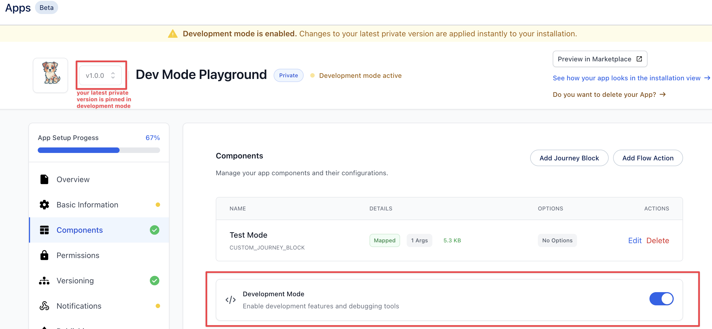
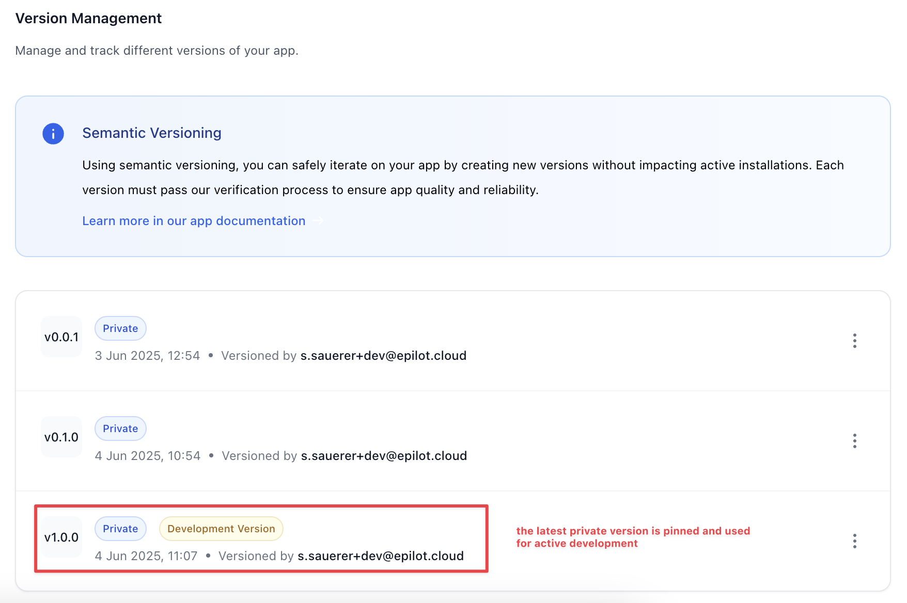
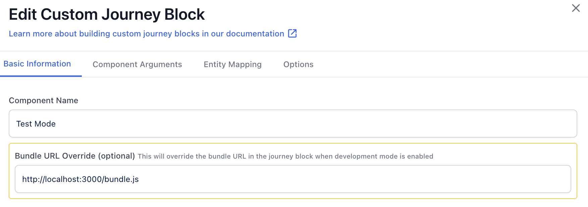

# Development Mode

Development mode lets you test changes to your App right away. While it is on, the installation of the App **in your own organization** always uses the components and options of the App's latest version, so you don't have to update the installation after every change.

It also lets you point a component at a different URL, for example a local development server.

:::info
Development mode only affects the organization that owns the App. Other organizations, including connected sandboxes, keep running the version they have installed. The App must be installed in your own organization for you to see the effect.
:::

## Switching it on

1. Open your App and select a private version.
2. Go to the **Components** section.
3. Turn on the **Development Mode** switch.

The switch is not shown while a public version is selected.

 

While development mode is on, you cannot create new versions. Switch it off before you [clone a version](/docs/apps/versioning#creating-a-new-version).

## Overriding component URLs

With development mode on, some components show an extra field to override where they are loaded from:

| Component | Field | Effect |
| --- | --- | --- |
| Custom Journey Block | **Bundle URL Override** | The block's bundle is loaded from this URL instead of the uploaded bundle. |
| Custom Workflow Action | **Dev URL Override** | The action's configuration interface is loaded from this URL. |

For example, set the Bundle URL Override of a journey block to your local development server. When you then open a journey that uses the block, it loads your local bundle, and you see your changes without uploading a new bundle.

The override only applies while development mode is on, and only in your own organization.
