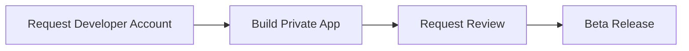

# Getting Started with App Development

Building and publishing an app on the epilot platform follows a straightforward process designed to help you move efficiently from initial setup to marketplace presence. This guide outlines the core steps you'll take on your journey to becoming an epilot app developer.

## The App Development Journey



## 1. Request Developer Account

Your first step is to obtain a dedicated developer sandbox account:

- Visit the [developer sandbox section](/docs/apps/getting-started/developer-sandbox) to learn about sandbox accounts
- Provide details about your organization and development plans
- Once approved, you'll receive credentials for your sandbox environment
- This isolated account provides a safe space to experiment with epilot's features

## 2. Build Your First Private App

Getting started is as simple as:

```bash
npx epilot app init my-app
```

This creates a local monorepo with a `manifest.json` — the declarative source of truth for your entire app. The manifest describes your app's metadata, components, permissions, and assets.

From there, use the CLI to add and remove components:

```bash
cd my-app

# Add a component (interactive type selector, or pass --type)
epilot app add-component my-block --type CUSTOM_JOURNEY_BLOCK

# Remove a component
epilot app remove-component my-block
```

Each CLI command updates the `manifest.json` automatically. You develop your components locally, and when you're ready:

```bash
# Build all components
npm run build

# Deploy — creates or updates the app on the epilot platform
epilot app deploy
```

`epilot app deploy` reads your manifest and syncs everything to the platform: it creates the app on first deploy, uploads component bundles, and keeps the remote state in sync with your local manifest.

See the [App CLI](/docs/apps/cli) page for all commands, and the [app-templates](https://github.com/epilot-dev/app-templates) repository for starter templates for each component type.

You can also build your app in the UI: open **Apps**, go to the **Your created Apps** tab and click **Create App**, or go straight to [https://portal.epilot.cloud/app/apps/configuration/new](https://portal.epilot.cloud/app/apps/configuration/new).

:::info

During this phase, your app is private. It is only visible to your organization and the [organizations connected to it](/docs/apps/getting-started/private-vs-public#private-apps-in-connected-organizations), such as your sandboxes.

:::

## 3. Request Review

If you want to offer your app to other epilot customers, a version of it has to pass a review:

1. Check the version against the [publishing requirements](/docs/apps/publishing/requirements).
2. Open your app, select the version you want to publish and go to the **Publishing** section.
3. Enter a technical and a marketing contact, confirm the requirements and click **Submit for Review**.

Our team checks the version and gets back to you if anything needs to change. The [verification process](/docs/apps/publishing/verification-process) page describes the review in detail.

An app that is only used in your own organizations does not need a review.

## 4. First Public Version

Once the review is approved:

- The version is public: it appears in the epilot Marketplace and other organizations can install it.
- The version can no longer be changed. To release changes, [create a new version](/docs/apps/versioning) and submit it for review.

To be notified by email when an organization installs your app, set a notification email and enable installation notifications in the **Notifications** section of your app.

## Next Steps

Ready to start your app development journey? Explore these resources:

- [Developer Sandbox Guide](/docs/apps/getting-started/developer-sandbox) - Learn more about setting up your development environment
- [Component Types](/docs/apps/components/overview) - Understand the different ways to extend epilot
- [Publishing Verification Process](/docs/apps/publishing/verification-process) - Learn about the review process for publishing apps

By following this streamlined process, you'll be able to contribute valuable solutions to the epilot ecosystem and reach organizations throughout the energy industry.