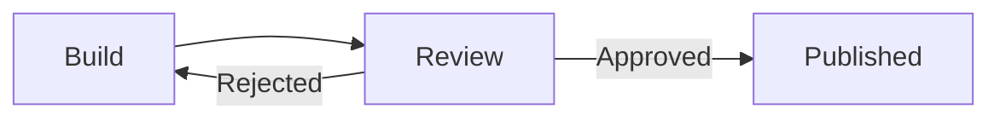

# Verification Process

Before a version of your App becomes public, the epilot team reviews it. The review checks that the version meets the [publishing requirements](/docs/apps/publishing/requirements), so that customers can rely on every App they find in the Marketplace.

This page explains how to request a review and what happens afterwards.

## What gets reviewed

A review always covers **one version** of your App, not the App as a whole. Each version you want to make public goes through its own review.

A version that has passed review is public and can no longer be changed. To release a change, [create a new version](/docs/apps/versioning) and submit that version for review.

## Before you request a review

1. **Check the requirements**: Go through the [publishing requirements](/docs/apps/publishing/requirements) and make sure the version meets them.
2. **Complete your documentation**: It should cover installation, configuration and troubleshooting.
3. **Test thoroughly**: Install the version in an organization other than the one you built it in, ideally a [sandbox](/docs/apps/getting-started/developer-sandbox), and verify that every component works as expected.
4. **Finish the version**: Reviewers check the version as you submitted it, so submit it only when it is complete.

## Requesting a review

1. Open your App in the App configuration and select the version you want to publish.
2. Go to the **Publishing** section.
3. Fill in the review request:
   - **Technical contact**: who we reach for technical questions, support requests and bug reports.
   - **Marketing contact**: who we reach for marketing and promotional questions.
   - **Demo link** (optional): a link to a demo or test environment where the App can be tried out.
4. Confirm that your App meets the publishing requirements.
5. Click **Submit for Review**.

The Publishing section then shows **Review in progress**, together with the version under review and the contacts you provided.

:::tip
A demo link is optional, but it speeds up the review. If your App depends on a third-party service, give us a way to test it, for example a test account.
:::

## During the review

The epilot team installs the version and checks it against the publishing requirements. Typical points are:

- whether the App does what its description says,
- how it handles credentials and customer data,
- which permissions it requests and why,
- how it behaves on errors and with missing configuration,
- whether the listing and documentation are complete.

If something is unclear, we get in touch with the technical contact you provided.

## After the review

A review ends in one of two ways:

- **Approved**: The version becomes public. It appears in the Marketplace and can be installed by every organization. The Publishing section shows that the version has passed review and is publicly available.
- **Rejected**: The version stays private. We tell you what needs to change. Fix the points, then request a review again.

## Publishing an update

Publishing a new version works the same way as publishing the first one:

1. Create a new version from the public one and make your changes.
2. Test the new version.
3. Request a review for the new version.

Until the new version is approved, customers keep using the version they have installed. Describe what changed when you create the version, so that reviewers and customers can see what the update contains.
