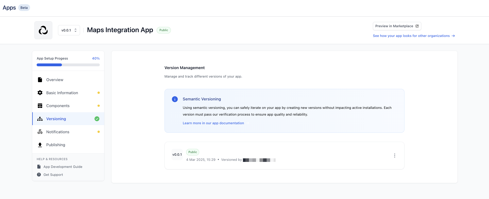
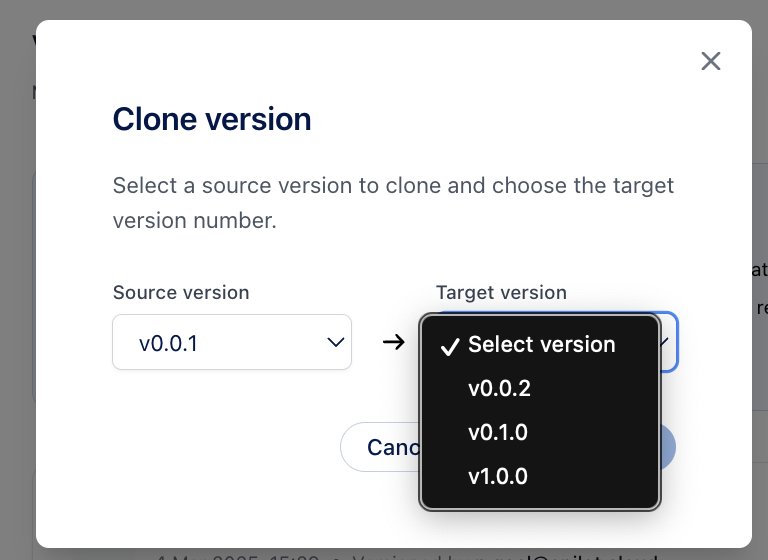

# Versioning

Every App has one or more versions. A version is a snapshot of the App's components, options, functions and permissions. Organizations install one specific version, so you can keep working on a new version without affecting anyone who has your App installed.

App versions follow [semantic versioning](https://semver.org/) (`major.minor.patch`). A new App starts at version `0.0.1`.

The **Versioning** section of your App lists all versions and whether each one is private or public.

## Private and public versions

- A **private** version can be changed at any time. It is visible to your organization and the [organizations connected to it](/docs/apps/getting-started/private-vs-public#private-apps-in-connected-organizations), such as your sandboxes.
- A **public** version has passed the [verification process](/docs/apps/publishing/verification-process) and is available to every organization. It can no longer be changed or deleted.

To change anything in a public version, create a new version from it.

## Creating a new version

You create a new version by cloning an existing one:

1. Open the **Versioning** section of your App.
2. Open the menu (⋮) of the version you want to start from and choose **Clone**.
3. Pick the new version number: a patch, minor or major increase of the version you clone.
4. Optionally describe what the new version changes (up to 250 characters).

The new version is a private copy of the original. Changes you make to it do not affect the original version or the organizations that have it installed.

:::info
You cannot clone a version while [development mode](/docs/apps/development-mode) is on. Switch it off first.
:::

## Publishing a version

To make a version public, request a review in the **Publishing** section. See the [verification process](/docs/apps/publishing/verification-process).

## Deleting a version

You can delete a version from its menu (⋮) in the **Versioning** section, unless:

- the version is public,
- it is the only version of the App, or
- another organization has this version installed.
