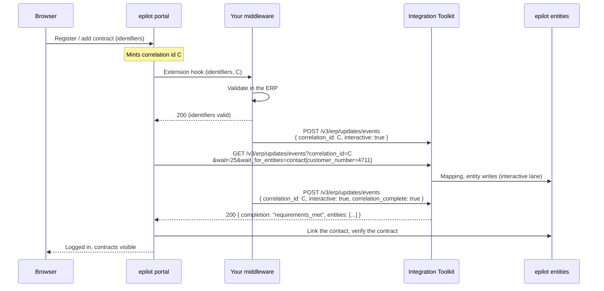

# Interactive Registration

Interactive registration is a mode of the [inbound API](./inbound/getting-started.md) for the flows where an end customer is waiting on screen: self-registration in the [End Customer Portal](/docs/portals/customer-portal), adding a contract or a customer account to an existing login, and public journeys that identify a customer.

Your push stays asynchronous. Each push carries the **correlation id** the portal passed to your extension hook, its events are processed on a dedicated, rate-limited **interactive lane**, and the portal **waits on that correlation** until the entities it needs have been written.

:::tip When to use it
- An end customer is waiting for your push to land: registration, contract addition, or customer identification in a journey.
- Your middleware answers a [portal extension hook](/docs/apps/components/portal-extension) such as `registrationIdentifiersCheck` or `contractIdentification` and then pushes the customer's data.

Bulk and scheduled syncs do not need it and keep using the inbound API as they are.
:::

## How It Works



Key properties:

- **One correlation per identification.** The portal mints a correlation id for each hook call. You send it on every push for that customer. Your hook response does not change.
- **A dedicated lane.** Interactive events do not queue behind bulk traffic. Each organization has a budget for interactive events; above it, events run on the normal lane and can still be waited on, only more slowly (see [Rate Limits](#rate-limits)).
- **The portal waits for what it needs.** It names the entities, and optionally the use cases, it needs and is answered as soon as they are written. The first match is enough (see [First Match Wins](#first-match-wins)).
- **An explicit end.** Closing the correlation with `correlation_complete: true` tells the portal that nothing more is coming. An account without a contract then becomes a precise message within seconds ("we found your account, your contract is not in our system yet") instead of a timeout.
- **Traceable afterwards.** Every interactive event and correlation can be read back through the API, and its monitoring events carry the `correlation_id`.

Without a correlation id and `interactive: true`, the portal searches for a contact and a contract that match what the end customer typed. That search cannot tell "not yet" from "never", so a slow or incomplete push ends in a generic timeout for the end customer.

## Before You Start

You need:

- the v3 inbound endpoint, `POST /v3/erp/updates/events`;
- an API token whose role has the **`integration:ingest`** grant on the integration you push to. `integration:*` and the owner role include it. A push without it is refused with **403** before anything is processed. Reading the [status endpoints](#checking-what-landed) needs `integration:view` as well;
- an inbound use case that allows interactive processing ([step 1](#allow-interactive-processing)); and
- a `slug` on every inbound use case, so that a wait can name it.

## Set It Up

### 1. Allow Interactive Processing on the Use Case {#allow-interactive-processing}

In the **Integration Hub**, open the inbound use case. The **General** card shows the current **Interactive processing** mode. Select **Change** and pick one of three options:

| Option | `interactive` value | Effect on a request that asks for interactive processing |
|---|---|---|
| **Off** | `disabled` (default) | The events are processed as bulk. Each result says `"interactive": false` with the message `Use case does not allow interactive processing`, and `INTERACTIVE_NOT_ALLOWED` appears in monitoring. Nothing is rejected. |
| **On request** | `on_request` | The request's `interactive: true` selects the interactive lane. This is the normal setting: one mapping serves both your scheduled sync and the registration push, and each request says which it is. |
| **Always** | `always` | Every event of the use case is interactive, whether the request asks or not — including events that send `interactive: false`, and requests without a correlation id, which get a generated one. Every such event is charged to the interactive budget, so a bulk sync routed to this use case uses up the budget the registrations need. Use it only for a use case that serves registrations alone. |

The choice is stored when you save the use case.

Through the API, the same setting is `interactive` on the use case `configuration`:

```json title="Inbound use case configuration"
{
  "entities": [ "..." ],
  "interactive": "on_request"
}
```

The field is optional and absent means `disabled`; to switch interactive processing off, remove the field rather than setting it to `disabled`. See [Inbound Use Case Options](./configuration.md#inbound-use-case-options) for the surrounding contract. A saved change takes up to 5 minutes to reach processing — see [Configuration Changes](#configuration-changes).

### 2. Push with the Portal's Correlation ID {#push-with-the-correlation-id}

The portal calls your hook with the identifiers the end customer entered and a correlation id. Validate the identifiers in the ERP and answer the hook as usual. Then send two fields on **every** push you make for that customer:

1. **`correlation_id`** — the id the portal passed to your hook, at request level.
2. **`interactive: true`**.

Both are needed. Only events processed as interactive are recorded for the wait, so a push that carries the correlation id without `interactive: true` leaves the portal nothing to wait on: it falls back to searching for the customer, as it does without interactive registration.

Use the id the hook passed, for that customer only. A fixed, hard-coded or reused correlation id puts every registration into one correlation and breaks the wait for all of them — see [Correlation IDs](#correlation-ids).

The examples on this page use one integration with two inbound use cases. Their entity targets are keyed like this, which matters for the wait later:

```json title="Entity targets of the example use cases (excerpt)"
// use case "customer_account"
"entities": [
  { "entity_schema": "contact",         "unique_ids": ["customer_number"],        "fields": [ "..." ] },
  { "entity_schema": "billing_account", "unique_ids": ["billing_account_number"], "fields": [ "..." ] }
]

// use case "contract"
"entities": [
  { "entity_schema": "contract",        "unique_ids": ["contract_number"],        "fields": [ "..." ] }
]
```

```bash title="First push — customer account"
curl -X POST 'https://integration-toolkit.sls.epilot.io/v3/erp/updates/events' \
  -H 'Authorization: Bearer <your-token>' \
  -H 'Content-Type: application/json' \
  -d '{
    "integration_id": "a1b2c3d4-e5f6-7890-abcd-ef1234567890",
    "correlation_id": "018f8e9b-5a1b-7c4e-9b2a-4f0f6c1d7a21",
    "interactive": true,
    "events": [
      {
        "use_case_slug": "customer_account",
        "timestamp": "2026-10-09T09:05:28Z",
        "format": "json",
        "payload": {
          "customerNumber": "4711",
          "firstName": "Anna",
          "lastName": "Schmitz",
          "email": "anna.schmitz@example.de",
          "billingAccountNumber": "300571"
        },
        "deduplication_id": "reg-4711-20261009090528"
      }
    ]
  }'
```

```json title="Response"
{
  "correlation_id": "018f8e9b-5a1b-7c4e-9b2a-4f0f6c1d7a21",
  "results": [
    {
      "event_id": "0199c3f2-8a41-7d0e-b6c7-2f1a9d3e4b55",
      "status": "success",
      "interactive": true,
      "lane": "interactive"
    }
  ]
}
```

`"interactive": true` confirms that the event can be waited on. See [Response Fields](#response-fields) for the cases in which it is `false`.

### 3. Close the Correlation {#close-the-correlation}

Closing the correlation with `correlation_complete: true` is strongly recommended, but not required — the wait works without it. Without a close, the portal can never know that you have finished. With it, a wait whose requirements cannot be met ends at once with the gap named, and a caller that needs everything can wait for the correlation to be complete rather than for the first match.

Where the close goes depends on how you push.

**One request after another.** Set `correlation_complete: true` on your last request:

```bash title="Last push — contract, and close the correlation"
curl -X POST 'https://integration-toolkit.sls.epilot.io/v3/erp/updates/events' \
  -H 'Authorization: Bearer <your-token>' \
  -H 'Content-Type: application/json' \
  -d '{
    "integration_id": "a1b2c3d4-e5f6-7890-abcd-ef1234567890",
    "correlation_id": "018f8e9b-5a1b-7c4e-9b2a-4f0f6c1d7a21",
    "interactive": true,
    "correlation_complete": true,
    "events": [
      {
        "use_case_slug": "contract",
        "timestamp": "2026-10-09T09:05:31Z",
        "format": "json",
        "payload": {
          "contractNumber": "200184",
          "customerNumber": "4711",
          "billingAccountNumber": "300571",
          "startDate": "2026-11-01"
        },
        "deduplication_id": "reg-4711-contract-20261009090531"
      }
    ]
  }'
```

**Several requests in parallel.** There is no last request: the one that carries the close may arrive before the others and turn them into late events. Send every event first, wait until each request has been accepted, then close the correlation with a request of its own that carries no events:

```bash title="After every parallel push was accepted — close the correlation on its own"
curl -X POST 'https://integration-toolkit.sls.epilot.io/v3/erp/updates/events' \
  -H 'Authorization: Bearer <your-token>' \
  -H 'Content-Type: application/json' \
  -d '{
    "integration_id": "a1b2c3d4-e5f6-7890-abcd-ef1234567890",
    "correlation_id": "018f8e9b-5a1b-7c4e-9b2a-4f0f6c1d7a21",
    "correlation_complete": true,
    "events": []
  }'
```

"Accepted" means the request answered with success for every event. If a push is answered with a retry (a 422 with partial results, or a 429), retry it until it is accepted before you send the close. Give every event a `deduplication_id`, so a retried request — a closing one included — is recognized as the same request and not processed a second time.

If you cannot place the close correctly, leave it out: a close that arrives too early does more harm than none. The response says whether the close was applied; see [Closing Rules](#closing-rules).

### 4. Handle the Failure Cases {#handle-the-failure-cases}

What the end customer reads when something goes wrong depends on how you handle these two cases.

**The customer exists, but data is missing.** Push what exists and close the correlation — on the same request, or, if you push in parallel, on a request of its own once every push was accepted. Then answer the hook with success as usual.

```json title="Account found, no contract in the ERP yet — the first push from step 2, closing the correlation (excerpt)"
{
  "integration_id": "a1b2c3d4-e5f6-7890-abcd-ef1234567890",
  "correlation_id": "018f8e9b-5a1b-7c4e-9b2a-4f0f6c1d7a21",
  "interactive": true,
  "correlation_complete": true,
  "events": [
    "<the customer_account event from step 2>"
  ]
}
```

As soon as that event is processed, the portal's wait ends `complete` with its contract requirement unmet, `CORRELATION_CLOSED_INCOMPLETE` names the missing contract in monitoring, and the portal can tell the end customer that their account was found but their contract is not in the system yet. If you push the partial data and leave the correlation open instead, the portal waits until it runs out of time and shows a timeout.

**The customer cannot be found.** Answer the hook with an error status and push **nothing** — no events and no close. An open correlation with no events looks exactly like a push that is still on its way. If you have already pushed under the correlation id before you learn that you cannot deliver, close it with `correlation_complete: true` and an empty `events` array, so the portal learns at once that nothing is coming.

## Request Reference

### Request Fields

`POST /v3/erp/updates/events` takes these fields for interactive processing, all at request level. `interactive` and `correlation_id` may also be set per event, and the event's value wins — the same precedence `group_id` follows.

| Field | Type | Description |
|---|---|---|
| `correlation_id` | string | The id the portal passed to your hook, or the one you returned from it ([Using Your Own Correlation ID](#using-your-own-correlation-id)). See [Correlation IDs](#correlation-ids) for the format. When omitted, one is generated and returned. |
| `interactive` | boolean | Request the interactive lane for this request's events. The use case must allow it ([step 1](#allow-interactive-processing)). |
| `correlation_complete` | boolean | No further events will follow for the request-level `correlation_id`. Send it once, on your last request, or on a request of its own with an empty `events` array. See [Closing Rules](#closing-rules). |

An empty `events` array is accepted only together with `correlation_complete: true`; otherwise it is a 400. Ingest never waits for processing: a `wait` field on the request or on an event is ignored.

### Response Fields

| Field | Description |
|---|---|
| `correlation_id` | The request's correlation id, echoed, or generated when you sent none — so a push without a portal in the loop still gets an id it can look up later. |
| `correlation_close` | Present when the request carried `correlation_complete: true`, on a 200, 422 or 429 alike. Says whether the close was applied; see [What Became of the Close](#what-became-of-the-close). |
| `results[].interactive` | `true` when the event was **processed as interactive**: it was recorded and the wait can see it. Present when interactive processing was requested, or the use case is set to `always`. |
| `results[].lane` | The lane that actually carried the event: `interactive`, or the organization's normal lane (`priority`, `default` or `deferred`). Over the [rate limit](#rate-limits) an event is still `"interactive": true` but runs on a normal lane. |
| `results[].message` | Why `interactive` is `false`. |

`interactive` is `false` — with the reason in `message` — when the use case does not allow interactive processing, the correlation already holds its 32 events, the correlation belongs to another integration, the event belongs to an `always` use case and its correlation id does not match the [format](#correlation-ids), or interactive processing is unavailable. In every case the event is processed as bulk on the normal lane, where the wait cannot see it. Nothing is rejected.

A request that does not ask for interactive processing is processed exactly as any other inbound push, unless its use case is set to `always`.

### Correlation IDs

- **Unique per identification.** One id per hook call, for that customer only. Never reuse an id across customers or attempts, and never send a constant.
- **Format.** 1 to 255 characters of `[A-Za-z0-9_-]`; a UUID fits. The rule applies to every request that can be waited on — `interactive: true` on the request or on an event, or `correlation_complete` — and such a request with an invalid id is rejected with **400** naming the rule. The wait's `correlation_id` parameter follows the same rule. Requests nobody can wait on are not checked.
- **At most 32 events per correlation.** A real registration is far below that. Further events under the id are processed as bulk, cannot be waited on, and raise `CORRELATION_EVENT_LIMIT_EXCEEDED`. If you see that code, you are almost certainly reusing an id.
- **One integration per correlation.** A correlation belongs to the integration whose event or close created it. Events that another integration sends under the same id are processed as bulk with `"interactive": false`, and its close is ignored. Use a distinct id for each integration.

### Closing Rules

- **The close needs a request-level `correlation_id`.** It closes that correlation and no other; the correlation is never inferred from per-event ids. `correlation_complete: true` without a request-level `correlation_id` is rejected with **400** and raises `CORRELATION_ID_MISSING`.
- **The request's own events count.** The correlation closes after the request's events are recorded. Closing twice is a no-op.
- **Only a fully accepted request closes.** A response that asks you to retry (a 422 with partial results, or a 429), or a request one of whose events the queue refused, closes nothing — so a close never overtakes events that are still being retried.
- **A retried close still closes.** If the response to your closing request was lost and you send it again with the same `deduplication_id`s, the events are skipped as duplicates and the close is applied to the correlation they were recorded under the first time.
- **A request with events never creates a correlation.** It closes one that exists, whatever became of its own events — also when some went over the 32-event limit. If the correlation does not exist yet and none of the request's events was recorded under it (the use case does not allow interactive processing, `interactive` was left out, or every event carried its own `correlation_id`), the close is ignored: closing an empty correlation would tell the portal "nothing is coming" while the data is being written.
- **A request without events creates the correlation closed.** For a correlation id epilot has never seen, it returns 200, raises `CORRELATION_CLOSED_EMPTY`, and the portal's wait answers `complete` with `events_received: 0` at once. Creating the correlation costs one unit of the [interactive budget](#rate-limits); closing one that exists costs nothing.
- **A mixed request closes the correlation.** When a request carries interactive and bulk events, `complete` covers only the interactive ones: the bulk events are processed, but the wait never sees them.

An event that arrives **after** the close is still processed. It counts as a late event and raises `CORRELATION_LATE_EVENT`, because by then the portal has usually answered the end customer. Once the correlation is complete, a late event no longer changes its answer.

#### What Became of the Close

Every request that sets `correlation_complete: true` gets a `correlation_close` object in its response. An applied close carries only its outcome — `{ "outcome": "applied" }`; `reasons` and `message` are present only when it was not applied.

```json title="Response — a close without events, while the budget is spent"
{
  "correlation_id": "018f8e9b-5a1b-7c4e-9b2a-4f0f6c1d7a21",
  "correlation_close": {
    "outcome": "rate_limited",
    "reasons": ["rate_limited"],
    "message": "..."
  },
  "results": []
}
```

| `outcome` | Meaning | What to do |
|---|---|---|
| `applied` | The correlation is closed — by this request, by an earlier one, or created closed by a request without events. | Nothing. |
| `rate_limited` | A close without events found no correlation, and the interactive budget could not pay for creating it (`rate_limit_unavailable` when the budget could not be checked). Until it is created, a wait on the id is not told that nothing is coming. | Send the same close again a few seconds later. |
| `ignored` | The close was not applied for a reason named in `reasons`. Monitoring raises `CORRELATION_CLOSE_IGNORED` with the same reasons. | See below. |

| Reason | What to do |
|---|---|
| `retry_requested` | The response is a 422 or a 429. Retry the request with `correlation_complete` still set; it closes then. |
| `queue_refused` | One of the request's events was refused. Send the close again once every event is accepted. |
| `other_integration` | The correlation belongs to another integration. Use a correlation id of your own. |
| `events_under_own_correlation_ids`, `events_duplicate`, `events_not_configured`, `events_not_interactive`, `events_unrecorded` | The correlation does not exist, and this request recorded none of its events under it: they carried their own correlation ids, were duplicates, matched no use case, or were not processed as interactive. Send the close under the correlation the events were recorded under, or send the events with `interactive: true` to a use case that allows it. |
| `close_failed` | The close could not be written. Send it again. |
| `interactive_unavailable` | Interactive processing is not available, so there is no correlation to close. |

## Checking What Landed

Three read endpoints show what your pushes produced. They need the **`integration:view`** grant on the integration the event or correlation belongs to — a token with `integration:ingest` alone cannot read what it pushed — and every lookup is limited to the token's own organization.

| Endpoint | Returns | Records kept |
|---|---|---|
| `GET /v3/erp/updates/events/{event_id}` | The processing record of one interactive event. Never waits. | 24 hours |
| `GET /v3/erp/updates/events?correlation_id={id}` | The summary of one correlation, optionally waiting until what the caller needs has arrived. | 7 days |
| `GET /v3/erp/updates/correlations` | The organization's correlations, newest first. | 7 days |

### One Event

```json title="GET /v3/erp/updates/events/0199c3f2-8a41-7d0e-b6c7-2f1a9d3e4b55"
{
  "event_id": "0199c3f2-8a41-7d0e-b6c7-2f1a9d3e4b55",
  "correlation_id": "018f8e9b-5a1b-7c4e-9b2a-4f0f6c1d7a21",
  "integration_id": "a1b2c3d4-e5f6-7890-abcd-ef1234567890",
  "status": "done",
  "lane": "interactive",
  "use_case_id": "58cf8956-e737-4b4c-a683-3528be3eedb8",
  "use_case_slug": "customer_account",
  "event_name": "customer_account",
  "ingested_at": "2026-10-09T09:05:28.412Z",
  "mapped_at": "2026-10-09T09:05:29.004Z",
  "done_at": "2026-10-09T09:05:30.277Z",
  "writes_total": 2,
  "writes_done": 2,
  "entities": [
    {
      "slug": "billing_account",
      "_id": "3f1b7e20-9c84-4a55-bd21-6e0d8a7c4f13",
      "operation": "created",
      "unique_ids": { "billing_account_number": "300571" }
    },
    {
      "slug": "contact",
      "_id": "9acc9f54-5c0a-4b3e-8e6f-1d2c3b4a5968",
      "operation": "created",
      "unique_ids": { "customer_number": "4711" }
    }
  ],
  "errors": [],
  "errors_total": 0
}
```

An event that was not processed as interactive has no record and returns **404**.

| `status` | Meaning |
|---|---|
| `accepted` | Accepted at ingest; the mapping has not run yet. |
| `processing` | The mapping ran and its entity writes are running. |
| `done` | Every write finished. An event that the mapping deliberately filters out writes nothing and is still `done`. |
| `partial` | Some writes succeeded, then a failure that will not be retried. |
| `error` | A failure that will not be retried, with nothing written. |

An event that cannot write what its use case describes is a failure, not a success with nothing to do: the use case is disabled (`USE_CASE_DISABLED`), it has no configuration for the event (`EVENT_NOT_CONFIGURED`), or the mapping could not extract an entity or a field it should have written. Such an event ends `error`, or `partial` when other writes succeeded.

- **`writes_total` and `writes_done`** count every entity write the event fanned out into, follow-up writes such as stub creates included, so `writes_done == writes_total` on a `done` record means the whole tree is finished. A write that found the entity already as described still counts, with `"operation": "unchanged"`.
- **`entities`** is sorted by slug, then `_id`. Find an entity by its slug and `unique_ids`, never by its position.
- **`event_name`** is the `event_name` you pushed, or your `use_case_slug` when you sent no `event_name` — not the use case's display name.
- **`ingested_at`, `mapped_at`, `done_at`** mark when the event was accepted, when the mapping had produced its entity updates, and when the last write finished. Their difference tells you whether a slow registration was slow on your side or in epilot.
- **`errors[]`** items are `{ "code", "message", "occurred_at" }`, where `code` is a [monitoring code](./monitoring/codes.md).

Both lists are bounded. `errors` holds the event's first 10 failures (a failure repeated within one item of your data is listed once), each message cut at 1,000 characters; `errors_total` counts every failure. `entities` lists at most 200 entity writes, and `entities_omitted`, present only when it is not zero, counts the rest — those entities were written all the same. If the record itself reaches its size limit, usually because of a payload with unusually many entities or very long unique ids, the event is ended `error` with `PROCESSING_STATE_LIMIT`. Its data may have been written, its correlation still completes, and anyone waiting on it is answered.

### Waiting on a Correlation

`GET /v3/erp/updates/events?correlation_id={id}` returns the summary across every event of one correlation. With `wait` it long-polls, and with requirements it returns as soon as what the caller needs has arrived. This is the call the portal makes.

| Parameter | Description |
|---|---|
| `correlation_id` | Required. The correlation to look at. |
| `wait` | Seconds to wait, `0` to `25`. Omit it or send `0` for an immediate answer. The ceiling keeps the call inside the 30-second HTTP limit; a value outside the range is a **400**, never silently clamped. |
| `wait_for_entities` | Entity requirements, each `slug` or `slug[key=value]`. **One requirement per occurrence** — repeat the parameter for several. See [Entity Requirements](#entity-requirements). |
| `wait_for_use_cases` | Inbound use case slugs. Repeat the parameter, or separate slugs with commas in one occurrence. See [Use Case Requirements](#use-case-requirements). |

Both requirement sets are optional and valid only together with `correlation_id`. Each set takes at most 20 requirements and each parameter at most 20 occurrences, empty occurrences included. Only the plain form is accepted: `wait_for_entities[]=`, `wait_for_entities[0]=` or `wait_for_use_cases[]=` is a **400**. When both sets are given, both must be satisfied for `requirements_met`.

```bash title="Wait for the customer's contact and a contract"
curl -G 'https://integration-toolkit.sls.epilot.io/v3/erp/updates/events' \
  -H 'Authorization: Bearer <your-token>' \
  --data-urlencode 'correlation_id=018f8e9b-5a1b-7c4e-9b2a-4f0f6c1d7a21' \
  --data-urlencode 'wait=25' \
  --data-urlencode 'wait_for_entities=contact[customer_number=4711]' \
  --data-urlencode 'wait_for_entities=contract' \
  --data-urlencode 'wait_for_use_cases=customer_account,contract'
```

```json title="Response"
{
  "correlation_id": "018f8e9b-5a1b-7c4e-9b2a-4f0f6c1d7a21",
  "integration_id": "a1b2c3d4-e5f6-7890-abcd-ef1234567890",
  "completion": "requirements_met",
  "closed": true,
  "closed_at": "2026-10-09T09:05:31.902Z",
  "complete": true,
  "completed_at": "2026-10-09T09:05:33.140Z",
  "events_received": 2,
  "events_done": 2,
  "late_events": 0,
  "first_ingested_at": "2026-10-09T09:05:28.412Z",
  "last_done_at": "2026-10-09T09:05:33.118Z",
  "use_cases": [
    { "use_case_slug": "contract", "received": 1, "done": 1, "error": 0 },
    { "use_case_slug": "customer_account", "received": 1, "done": 1, "error": 0 }
  ],
  "entities": [
    {
      "slug": "billing_account",
      "_id": "3f1b7e20-9c84-4a55-bd21-6e0d8a7c4f13",
      "operation": "created",
      "unique_ids": { "billing_account_number": "300571" }
    },
    {
      "slug": "contact",
      "_id": "9acc9f54-5c0a-4b3e-8e6f-1d2c3b4a5968",
      "operation": "created",
      "unique_ids": { "customer_number": "4711" }
    },
    {
      "slug": "contract",
      "_id": "c0d9a1b8-4e37-4f52-8a90-5b6c7d8e9f01",
      "operation": "created",
      "unique_ids": { "contract_number": "200184" }
    }
  ],
  "errors": [],
  "errors_total": 0
}
```

- **`closed`** says you sent `correlation_complete`. **`complete`** says the correlation is closed and every event it received has finished — read it, and `completed_at`, rather than comparing `events_done` with `events_received`.
- **`first_ingested_at` and `last_done_at`** span the end-to-end time of the whole correlation.
- **`use_cases`** has one item per use case the correlation's events were routed to, with how many were `received`, are `done` and ended in `error` (`partial` counts as `error`). It is sorted by `use_case_slug`; `entities` by slug, then `_id`.
- **`errors[]`** items have the same shape as on a single event, plus the `event_id` that failed. The correlation lists its first 50 failures, and `errors_total` counts all of them, including failures of events that arrived after the correlation completed, which carry `"after_completion": true`.
- **`entities`** lists at most 200 entity writes; `entities_omitted`, present only when it is not zero, counts the rest. See [Undecided Requirements](#undecided-requirements).

A correlation id epilot has never seen reads as `events_received: 0, closed: false`. Waiting before anything was sent is the portal's normal case — it mints the id, calls your hook and waits before you push — so such a wait long-polls like any other and picks the correlation up as soon as its first event is ingested. If nothing arrives, it answers `timeout`: without a close, "not yet" and "never" look the same.

#### Values of `completion`

| Value | Meaning |
|---|---|
| `requirements_met` | Every requirement given is satisfied. The wait returns the moment this becomes true, even if an unrelated event of the correlation failed — `errors` still lists the failure. |
| `complete` | The correlation is closed and every event received for it has finished. This is the end point for a caller that wants everything, and it also ends a wait whose requirements can no longer be met — which is how the portal learns that you sent an account but no contract. |
| `timeout` | The wait ran out, or, with `wait=0`, nothing is decided yet. The body lists everything that landed so far; call again to keep waiting. With no requirements and no close, a wait always ends this way. |
| `error` | A requirement can no longer be met: every event of a required use case failed, or the correlation is complete with a required entity missing and an event failed. Without requirements: the correlation is complete and one of its events failed. |

**Once a correlation is complete, its answer is final.** The verdict is fixed at `completed_at`. A later event is still processed and counted in `late_events`, but it never changes `completion`, `use_cases` or `entities` — a caller told `complete` or `requirements_met` is never contradicted by a later read.

A requirement is satisfied when the event that carries it is **`done`** — its writes finished — not when it was received, so the entities the response lists exist when the caller reads them. A failed event ends the wait as follows:

- A **use case requirement** becomes `error` as soon as every event of that use case received so far has failed.
- An **entity requirement** cannot be traced to a single event, so it becomes `error` only once the correlation is complete with the entity still missing and an event failed. On an open correlation, such a wait runs until it times out, although the failure is in `errors[]` from the moment it happens. Closing the correlation turns that into an immediate `error`.

If the contract event of the example had linked its billing account by an `_id` that does not exist, a wait on `wait_for_use_cases=contract` would end like this:

```json title="Response (excerpt) — a requirement that can no longer be met"
{
  "completion": "error",
  "use_cases": [
    { "use_case_slug": "contract", "received": 1, "done": 0, "error": 1 },
    { "use_case_slug": "customer_account", "received": 1, "done": 1, "error": 0 }
  ],
  "errors": [
    {
      "code": "ENTITY_REFERENCE_NOT_FOUND",
      "message": "Referenced entity 7d2e4c19-0b6a-4f3e-9a51-c8e2d0f4b6a7 not found (expected schema 'billing_account')",
      "event_id": "0199c3f5-1b07-7a2e-8d44-9e3c6f0a2b18",
      "occurred_at": "2026-10-09T09:05:32.640Z"
    }
  ],
  "errors_total": 1
}
```

#### Entity Requirements

`slug` is satisfied by any processed entity of that slug in the correlation. `slug[key=value]` is satisfied by a processed entity of that slug whose `unique_ids` contain the pair. A deleted entity never satisfies a requirement.

Each entity in a response carries `unique_ids`, and that map holds **exactly the `unique_ids` configured for that entity target in the use case — nothing else**. In the example, the contact carries `customer_number` because that is its target's only unique id; its `email`, `first_name` and every other mapped attribute are not there, however identifying they look.

:::caution A selector can only name a configured unique id
A selector on any other attribute could never match, so the wait rejects it with **400**. The check is against the `unique_ids` configured for that entity slug across all of the organization's inbound use cases, so it works before the correlation exists. A slug that no inbound use case writes is a 400 as well, and `_id` is never a selector key. Treat the 400 as a configuration error to fix, not as a reason to retry.
:::

```json title="400 — a selector key that is not a configured unique id"
{
  "message": "wait_for_entities selector 'contact[email=anna.schmitz@example.de]' can never match: 'email' is not a unique id of 'contact' in any inbound use case of this organization. A selector can only name one of: customer_number",
  "slug": "contact",
  "rejected_key": "email",
  "allowed_keys": ["customer_number"]
}
```

When no inbound use case writes the slug, `rejected_key` is absent and `allowed_keys` is empty.

In the example integration:

- `contact[customer_number=4711]` is satisfied only by a contact whose `unique_ids` contain `customer_number: "4711"`.
- `contract[contract_number=200184]` is satisfied only by that contract. Use it when the caller already knows the contract, as when adding a contract to an existing login.
- `contact` is satisfied by **any** contact under the correlation. Use it only when the correlation cannot contain more than one: some ERPs write two contacts for one business partner, and other use cases — document metadata, for example — can write contacts too.

When the identifier the caller holds is not a configured unique id, either derive one that is (for example, a composite number whose parts include a unique id), or wait on an unambiguous requirement such as `contract` and reach the right contact through the delivered contract's `customer` relation by `_id`. A contract is listed only once its relations are set, so that relation is there when the wait returns.

##### Selector Syntax and Encoding

- **Key and value.** Inside `slug[key=value]` the key ends at the **first** `=` and the value runs to the final `]`, so a value may itself contain `=`, `]` and `,`.
- **One requirement per occurrence.** A `wait_for_entities` occurrence is never split on commas, so a comma inside a value needs no special treatment. Selectors joined by a comma in one occurrence, such as `contact[customer_number=4711],contract[contract_number=200184]`, are a **400** telling you to repeat the parameter. The comma-separated form exists only for `wait_for_use_cases`.
- **Encode once.** Encode each parameter once, the standard way for a query string, as `curl -G --data-urlencode`, `URLSearchParams` and the SDK do. A value you pre-encode before handing it to one of these is encoded twice and arrives as escape sequences: `A,B` pre-encoded to `A%2CB` matches nothing.
- **Length.** A value longer than **256** UTF-16 code units (JavaScript's `length`), not counting surrounding whitespace, is a **400**: unique ids that long are not recorded, so it could never match. An emoji counts 2.
- **Matching.** The selector value and the recorded unique id are both compared after trimming surrounding whitespace and lower-casing, so `contact[customer_number=ab-1001]` matches a contact stored with ` AB-1001 `. Whitespace inside the value stays significant: `MELO 001` does not match `MELO001`. For the ASCII identifiers ERPs use, this behaves like the toolkit's entity lookup by unique id; for letters with special case rules (Turkish `İ`, Greek final `ς`) and non-breaking spaces it may not, so build such selectors from exactly the string you push.
- **Recording bound.** Each entity write records its slug, `_id`, `operation` and unique ids in at most 1,024 bytes of UTF-8 JSON. Unique ids are recorded in alphabetical order of their keys while they fit; one that does not fit is missing from `unique_ids`, and a selector on it can never match. Customer, contract and meter numbers are nowhere near this bound.

```bash title="A contract number that contains a comma and a slash"
curl -G 'https://integration-toolkit.sls.epilot.io/v3/erp/updates/events' \
  -H 'Authorization: Bearer <your-token>' \
  --data-urlencode 'correlation_id=018f8e9b-5a1b-7c4e-9b2a-4f0f6c1d7a21' \
  --data-urlencode 'wait=25' \
  --data-urlencode 'wait_for_entities=contact[customer_number=4711]' \
  --data-urlencode 'wait_for_entities=contract[contract_number=2001/84,A]'
```

On the wire, the second requirement is `wait_for_entities=contract%5Bcontract_number%3D2001%2F84%2CA%5D` — one parameter, encoded once.

With the SDK, pass one array item per requirement, with the raw value; the client encodes each item once and repeats the parameter:

```ts title="The same wait with the SDK"
import { authorize, getClient } from '@epilot/sdk/integration-toolkit'

const toolkit = getClient()
authorize(toolkit, () => '<your-token>')

const { data } = await toolkit.queryErpUpdateEvents({
  correlation_id: correlationId,
  wait: 25,
  wait_for_entities: [
    `contact[customer_number=${customerNumber}]`,
    `contract[contract_number=${contractNumber}]`,
  ],
  wait_for_use_cases: ['customer_account', 'contract'],
})
```

Without the SDK, build the query with `URLSearchParams` and `append` each requirement:

```ts title="The same wait with axios and URLSearchParams"
const params = new URLSearchParams({ correlation_id: correlationId, wait: '25' })
params.append('wait_for_entities', `contact[customer_number=${customerNumber}]`)
params.append('wait_for_entities', `contract[contract_number=${contractNumber}]`)
params.append('wait_for_use_cases', 'customer_account')
params.append('wait_for_use_cases', 'contract')

const { data } = await axios.get('https://integration-toolkit.sls.epilot.io/v3/erp/updates/events', {
  params,
  headers: { Authorization: `Bearer ${token}` },
})
```

##### Undecided Requirements

An entity counted only in `entities_omitted` may well have been written, but the wait cannot see it. So once a correlation has omitted entities, an entity requirement that no listed entity satisfies is **undecided** — neither met nor missing. The response names it, exactly as you passed it, in `undecided_entity_requirements`; it never makes `completion` `error`; and the wait ends `complete` once the correlation completes, even when every other requirement is met. Look such an entity up yourself, for instance by its unique id through the entity API. Use case requirements are never undecided.

```json title="Response (excerpt) — an entity requirement the correlation could not list"
{
  "completion": "complete",
  "entities_omitted": 14,
  "undecided_entity_requirements": ["contract[contract_number=200184]"]
}
```

#### Use Case Requirements

`wait_for_use_cases` takes inbound **use case slugs** — the same `use_case_slug` you send on the push. Slugs are unique within an integration and portable across environments, which is why requirements name use cases by slug rather than by `event_name`.

A requirement is met when **at least one event of that use case is `done`**. An event that ends `partial` does not meet it, because part of what the use case should have written is missing. Use case requirements take no selectors.

A slug that no inbound use case of the organization has can never match and is refused with **400**, naming it in `use_case_slug`. So is an entry that is not a well-formed slug — slugs are lower case, so `Customer_Account` is refused rather than matched against `customer_account` — and, on a correlation that already belongs to an integration, a slug that only another integration's use cases have.

:::tip If you want to wait on use cases
1. **Model one inbound use case per partner event type.** If your ERP sends a customer message and a contract message, give each its own use case. A single use case that maps both is satisfied by the customer message alone, so a wait on it cannot tell "the contract arrived" from "only the customer arrived".
2. **Give every use case a slug.** A use case without one is listed in `use_cases` under its id, which differs between your sandbox and production organizations.
:::

The example integration follows both rules: `customer_account` and `contract` are separate use cases, each with a slug.

#### First Match Wins

**Every requirement is satisfied by the first matching event, not by all of them.** A use case requirement is met by the first event of that use case to reach `done`, and an entity requirement without a selector by the first entity of that slug. Neither says anything about the rest.

For example, Anna Schmitz has three contracts, `200184`, `200185` and `200186`, and your ERP sends one `contract` event for each, a second apart:

| The caller waits on | It returns `requirements_met` when |
|---|---|
| `wait_for_use_cases=contract` | the first of the three contract events is done. The other two are still on their way. |
| `wait_for_entities=contract` | the first contract entity is written. Same as above. |
| `wait_for_entities=contract[contract_number=200185]` | contract `200185` is written — that one and no other. |
| no requirements, waiting for `completion: "complete"` | you sent `correlation_complete: true` and all three contracts are done. |

So naming several use cases, such as `customer_account,contract`, covers a bundle that spans use cases, but not one use case firing several times. When the caller knows the identifier, it selects on it — adding a contract to an existing login waits for `contract[contract_number=…]`. And without a close, `requirements_met` does not mean you have finished: the portal shows what has landed, and the rest appears on the next page load.

#### Choosing Requirements

Use **entity requirements** when the caller needs the entity itself: they express the goal — *the customer's contact and a contract exist* — and the response carries the ids to link and verify. The portal uses them for registration and contract addition.

Use **use case requirements** when the caller needs to know that the kind of data it expects arrived, rather than that a specific entity appeared:

- when the **set of entities varies per push** — one customer brings two contracts and a meter, the next one contract and nothing else; and
- when a use case's result is **not a new entity** — meter readings, files, a relation on an existing entity, or an event the mapping filters out. An entity requirement could never be met there, and the wait would time out on a correlation that in fact succeeded. For meter readings, a use case requirement is how a wait names them.

Combining them is normal: `wait_for_entities=contact[customer_number=4711]` names the entity the portal needs to link, and `wait_for_use_cases=customer_account,contract` lets the failure message name the kind of data that never came.

#### Concurrent Waits

Waits are limited per organization and overall. A wait that starts before anything was sent under its correlation counts against a separate cap of **10 per organization** for its whole duration, so waits on ids nothing is ever sent under cannot crowd out waits on correlations that exist. Over a cap, the call answers **429** with a `Retry-After` header instead of waiting, and raises `CORRELATION_WAIT_REJECTED`. Retry after `Retry-After`, or fall back to `wait=0`. A call that does not have to wait — `wait=0`, or a correlation that is already decided — is never refused.

### Recent Correlations

`GET /v3/erp/updates/correlations` lists the organization's correlations, **newest first**. Use it to find a correlation that went wrong when you do not have its id: a correlation that is merely stuck raises no monitoring code, so nothing else points at it.

| Parameter | Description |
|---|---|
| `integration_id` | Optional. Only correlations of this integration. Without it, the listing needs `integration:view` on every integration of the organization. |
| `limit` | Page size. Default 50; values above 100 are treated as 100. |
| `cursor` | Pass the previous page's `next_cursor` to continue. |

```bash title="The latest correlations of one integration"
curl -G 'https://integration-toolkit.sls.epilot.io/v3/erp/updates/correlations' \
  -H 'Authorization: Bearer <your-token>' \
  --data-urlencode 'integration_id=a1b2c3d4-e5f6-7890-abcd-ef1234567890' \
  --data-urlencode 'limit=50'
```

```json title="Response (excerpt)"
{
  "results": [
    {
      "correlation_id": "018f8e9b-5a1b-7c4e-9b2a-4f0f6c1d7a21",
      "integration_id": "a1b2c3d4-e5f6-7890-abcd-ef1234567890",
      "closed": true,
      "closed_at": "2026-10-09T09:05:31.902Z",
      "complete": true,
      "completed_at": "2026-10-09T09:05:33.140Z",
      "events_received": 2,
      "events_done": 2,
      "late_events": 0,
      "first_ingested_at": "2026-10-09T09:05:28.412Z",
      "last_done_at": "2026-10-09T09:05:33.118Z",
      "use_cases": [
        { "use_case_slug": "contract", "received": 1, "done": 1, "error": 0 },
        { "use_case_slug": "customer_account", "received": 1, "done": 1, "error": 0 }
      ],
      "entities": [ "..." ],
      "errors": [],
      "errors_total": 0
    }
  ],
  "next_cursor": "<opaque cursor>",
  "horizon_days": 7
}
```

Each item in `results` is the same correlation summary the wait returns, without `completion`.

- **Only a `null` `next_cursor` ends the listing.** A page can be shorter than `limit`, or even empty, and still carry a cursor, because a listing filtered by `integration_id` reads a bounded slice of the organization's correlations per call. Keep paging until the cursor is `null`.
- **The cursor is opaque, but not secret.** Pass it back exactly as you received it. It may encode correlation ids and times of other integrations of the organization, so keep it where only people with access to the listing can read it, and do not put anything in a correlation id you would not want them to see.
- **`horizon_days`** says how far back the listing reaches: 7 days, the lifetime of a correlation record. Older correlations are gone, not hidden.

## Rate Limits

The interactive lane stays fast because no single organization can fill it. Every organization has a budget for interactive events: by default a sustained **120 interactive events per 5 minutes, with a burst of 40**. Organizations with higher registration volume can agree a higher budget with epilot.

How a request is charged:

- **Once per request, at ingest, for the events it admits as interactive.** Duplicates, events rejected with 422 and events over a correlation's 32-event limit cost nothing, so a retry pays only for the events it newly admits.
- **The charge is the number of those events, capped at the burst:** `min(events, burst)`.
- **All or nothing.** If the budget cannot cover the whole charge, all of the request's events run on the normal lane. A request is never split across lanes.
- **A close without events** costs one unit, and only when it creates the correlation. Closing a correlation that exists costs nothing. When the budget is spent, such a close still closes a correlation that exists, but creates none, and `correlation_close` says `rate_limited`.

When the budget is spent, nothing is rejected and nothing is lost:

- The events are processed on the organization's normal lane. Their results keep `"interactive": true`, and `lane` names the lane that carried them.
- They are still recorded, so the close, the wait and the status endpoints keep working. The answer simply takes as long as a bulk event does, and the portal's wait may time out and retry.
- `INTERACTIVE_RATE_LIMITED` appears in monitoring for the request.

A steady stream of `INTERACTIVE_RATE_LIMITED` usually means that a bulk sync sets `interactive: true` on every request. Bulk pushes are not slower without the flag, but with it they use up the budget your registrations need.

## Configuration Changes

A saved change to an inbound use case does not reach every step at the same moment:

- **Ingest** reads the use case as saved, so the `interactive` option applies from the next push on.
- **The wait** checks requirements against the configuration as it is when the call arrives, so a use case slug or a unique id you saved seconds before is accepted. A use case or unique id you **removed** up to about a minute earlier may still be accepted; such a requirement can then never be met.
- **Processing** picks up a changed mapping, changed unique ids, or a use case you enabled or disabled within up to **5 minutes**. Events pushed in the meantime are processed with the previous configuration.

So a wait that names a unique id you have just added is accepted at once, but an event pushed in the next few minutes may still be mapped without it, and the wait ends `complete` or `timeout` with the requirement unmet. A use case you have just disabled may likewise still process events for a few minutes before they fail with `USE_CASE_DISABLED`. After changing a use case, allow 5 minutes before you test the change.

## Using Your Own Correlation ID

You only need this if you push under an id of your own rather than the portal's — for example, because your middleware already threads a transaction id through every push.

Return that id in your hook response, and declare in the app's hook configuration where it is, with `result_correlation_id` — for example `{{CallResponse.data.acknowledgeId}}`. The portal then waits on your id instead of its own.

- There is no default: a `correlation_id` field in your hook response is ignored unless the hook declares it, so an unrelated field of that name cannot redirect the wait.
- If the declared id is missing from the response, the portal waits on its own id.
- If the declared id does not match the [correlation id format](#correlation-ids), there is nothing to wait on, and the portal falls back to searching for the customer.

## Event-Stream Integrations

If your ERP backend publishes change events to Kafka or a comparable log, and epilot consumes that stream, the contract is the same. Only the carrier differs: the epilot bridge that consumes your stream sets the inbound request fields for you.

:::tip The minimum
1. **Return an acknowledge id from the synchronous endpoint** the portal hook calls — the assignment or registration endpoint you already have. That id is the correlation id.
2. **Echo it as a CloudEvents extension on every event the operation produces**, as the `ce_correlationid` header or as `correlationId` in the event envelope's extensions.
:::

The bridge maps the extension to `correlation_id` and sets `interactive: true` on any batch that carries one, so the portal's requirements are met as soon as the matching events are processed. The [first match wins](#first-match-wins) here exactly as over HTTP.

Two further steps are recommended:

- **Publish a terminal event last, on the same message key** as the data events — a name such as `AssignmentCompleted`, with no business payload. The bridge turns it into `correlation_complete: true` on the inbound request that carries it and does not forward it as data, so it needs no mapping and no use case. Without it, data you never send looks like data still on its way until the wait times out; with it, the wait ends at once with the missing requirement named.
- **Emit every event the operation produced.** An assignment that changes a business partner but publishes no contract or meter event still fails for the end customer — with a terminal event, at least within seconds and with the missing requirement named.

:::caution Keep one operation on one key
Per-key ordering is what makes a terminal event meaningful: it guarantees that the data events for that key were forwarded before it. If your stream splits one business operation across several keys — the contract on one, the meter on another — the terminal event no longer follows them, and the close can arrive before the data.
:::

## Common Mistakes

- **Making the push synchronous.** `wait` on `POST /v3/erp/updates/events` is ignored. Ingest validates, enqueues and answers; it never blocks on processing.
- **Calling the wait from inside your hook.** A middleware may push, call the correlation wait itself and only then answer the hook. It is supported, but it ties your hook's timeout (typically 20 seconds) to epilot's processing time, so a slow correlation fails the hook instead of producing a precise message, and the portal's retry loop is lost. Answer the hook as soon as the ERP has validated the identifiers, push with the portal's correlation id, and let the portal wait.
- **Opening a correlation for a customer you could not find.** Answer the hook with an error and push nothing; see [step 4](#handle-the-failure-cases).
- **Reusing a correlation id, or sending a constant one.** One id per identification; see [Correlation IDs](#correlation-ids).
- **Putting the close on one of several parallel requests.** Close with a request of its own once every push was accepted, or leave the close out; see [step 3](#close-the-correlation).
- **Setting `interactive: true` on bulk syncs.** They use up the budget the registrations need; see [Rate Limits](#rate-limits).
- **Selecting on an attribute that is not a configured unique id.** It can never match, so the wait rejects it with 400; see [Entity Requirements](#entity-requirements).
- **Joining entity requirements with commas, or encoding values twice.** Repeat `wait_for_entities` once per requirement and encode each once; see [Selector Syntax and Encoding](#selector-syntax-and-encoding).

## Monitoring

Interactive processing raises its own codes in the [Monitoring tab](./monitoring/overview.md), alongside the usual entity events. Every one of them except `CORRELATION_ID_MISSING` carries the `correlation_id`, so you can filter one registration end to end.

| Code | Level | Raised when |
|---|---|---|
| `INTERACTIVE_RATE_LIMITED` | warning | An interactive request exceeded the organization's budget and ran on the normal lane. |
| `INTERACTIVE_NOT_ALLOWED` | info | `interactive: true` arrived for a use case whose `interactive` setting is `disabled`. |
| `INTERACTIVE_CROSS_LANE_WRITE` | warning | The same entity was written on the interactive lane and on another lane within 60 seconds, in either order — typically a bulk sync and a registration push for the same customer. Both writes were applied. |
| `CORRELATION_COMPLETED` | info | A correlation became complete, with its event and entity counts and the ingest-to-complete duration. |
| `CORRELATION_CLOSED_EMPTY` | info | A correlation was closed without any event — you reported that nothing is coming for this customer. |
| `CORRELATION_CLOSE_IGNORED` | warning | A close was not applied. `detail.reasons` holds the same reasons as the response's [`correlation_close`](#what-became-of-the-close). |
| `CORRELATION_CLOSED_INCOMPLETE` | warning | A wait ended `complete` without its requirements met: the correlation was closed without what was asked for. The details list `missing_entities`, `missing_use_cases` and `undecided_entities`. |
| `CORRELATION_LATE_EVENT` | warning | An event arrived after the close. It is processed, but does not change a complete correlation's answer. |
| `CORRELATION_EVENT_LIMIT_EXCEEDED` | warning | A correlation already held its 32 events, so further events under its id were processed as bulk. |
| `CORRELATION_ID_MISSING` | error | A request set `correlation_complete: true` without a request-level `correlation_id` and was rejected with 400. |
| `CORRELATION_REQUIREMENT_FAILED` | error | A wait ended `error` because an event a requirement depends on failed. The details name the requirement and the failing event. |
| `CORRELATION_WAIT_TIMEOUT` | warning | A wait ran out before its requirements were met. The details list `missing_entities` and `missing_use_cases`. |
| `CORRELATION_WAIT_REJECTED` | warning | A wait was refused with 429 because a cap on concurrent waits was reached — with `scope: recordless`, the cap on waits for correlations nothing was sent under yet. |
| `PROCESSING_STATE_LIMIT` | error | An interactive event's processing record reached its size limit, so the event was ended `error`. Its correlation still completes, and its data may have been written. |

`CORRELATION_CLOSED_INCOMPLETE`, `CORRELATION_WAIT_TIMEOUT` and `CORRELATION_REQUIREMENT_FAILED` are raised once per correlation, never by a `wait=0` read — so a portal that retries the wait counts one end customer, not one per attempt. `CORRELATION_WAIT_TIMEOUT` and `CORRELATION_CLOSED_INCOMPLETE` are warnings because an end customer waited and was shown nothing. `CORRELATION_CLOSED_EMPTY` is only info: closing a correlation you have nothing for is exactly what this page asks, and the portal got its answer at once.

See the [code reference](./monitoring/codes.md) for every code.

## Limits

| Limit | Value |
|---|---|
| Correlation id | 1–255 characters of `[A-Za-z0-9_-]` |
| Events per correlation | 32 |
| `wait` | 0–25 seconds |
| Requirements per set, occurrences per parameter | 20 each |
| Selector value | 256 UTF-16 code units |
| Recorded unique ids per entity write | 1,024 bytes |
| Listed failures | 10 per event, 50 per correlation (each message cut at 1,000 characters) |
| Listed entity writes | 200 per event and per correlation |
| Concurrent waits before anything was sent | 10 per organization |
| Interactive budget | 120 events per 5 minutes, burst 40 (default) |
| Event records / correlation records | kept 24 hours / 7 days |
| Configuration change reaching processing | up to 5 minutes |

## A Runnable Reference

The [erpilot-integration](https://github.com/epilot-dev/erpilot-integration) demo implements this page end to end against a demo ERP: the hook handler that takes the portal's correlation id, the pushes that carry it, the request that closes the correlation, and both failure cases.

## Next Steps

- [Inbound Getting Started](./inbound/getting-started.md) — the inbound API this builds on
- [Unique Identifiers](./inbound/unique-identifiers.md) — how `unique_ids` are configured, and so what a selector can name
- [Use Cases](./use-cases.md) — the catalogue of standard inbound and outbound flows
- [Portal Extensions](/docs/apps/components/portal-extension) — the hooks the portal calls during registration and contract addition
- [Monitoring Codes](./monitoring/codes.md) — every code, what it means, and what to do about it
